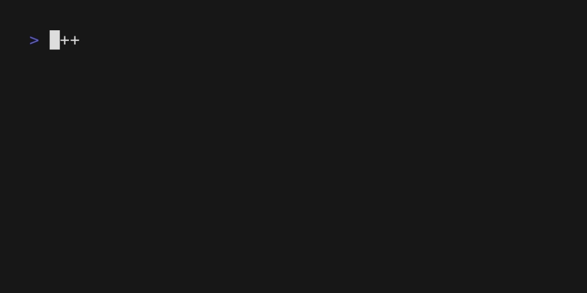

<!-- Code generated by gomarkdoc. DO NOT EDIT -->

# DSL For Programming Practice (BUPT) 

## 暂时就叫“波普特鼠人客服/解释器”🤔

⚠️本项目为北京邮电大学《程序设计实践》课程所要求课程设计，这个项目并不适合真的来实现DSL，小幅修改+**强行解释**作为课程大作业，但涵盖了课程设计中的大部分要求

参考自索斯藤·鲍尔（Thorsten Ball）的[《用GO语言自制解释器》](https://book.douban.com/subject/35909085/)

适合想体验GO语言+体验手撕解释器+恰好选中这门课程的同学作为参考（但这个项目和Go语言关系不大）

底下这些洋文是chrome book输入法打架导致的

⚠️ This project is a course design required for the "Programming Practice" course at Beijing University of Posts and Telecommunications (BUPT)

Referenced from Thorsten Ball's ["Writing An Interpreter In Go"](https://interpreterbook.com/), this project is not really suitable for implementing DSL 

Suitable as a reference for students who want to experience the GOlang + experience writng an interpreter + have taken this course


A simple DSL, which helps you build your own bot. support basic data types, such as integer, boolean, string, array have builtin functions, such as len, first, last, rest, push support user defined function support if\-else statement support user defined function Example for a simple program:

By setting env in your shell, awesomeDSL support openai-api, please check [doc](./doc/README.md) for more details.

the DSL is crazy simple, but it's enough for a simple bot

`let question_without_space` = variable, function call, if-else statement, builtin function

when you type question, the bot will answer you with value at right of `=`

for example, 

with `let a = 1`, when you type 'a', the bot will answer you with '1'

for more examples, please check in [examples](./example/)
```
//builtin function
let hello = puts("hello world");
//variables
let a = 1;
let b = 2;
let c = true;
let d = "hello world";
//define function 
let add = fn(x, y) {
	x + y;
};
//call function
let result = add(a, b);
//if-else statement
let tellmeresult= if (result > 0) {
	"result is positive";
} else {
	"result is negative";
};
//array
let arr = [1, 2, 3];
//array builtin function
let first = first(arr);
let last = last(arr);
let rest = rest(arr);
//array push
let arr2 = push(arr, 4);
//array len
let len = len(arr2);
//array index
let index = arr2[0];
//string concat
let len = "hello"+" world";
```

## Documentation
you can check the [doc](./doc/) for more details.

## Quick Start
`go build main.go`

`./main <your_script.txt>`



## thanks to those 🙏
[bubbletea](https://github.com/charmbracelet/bubbletea) build tui by this framework.

[vhs](https://github.com/charmbracelet/vhs) The gifs in this repo were all made by this tool;

[gomarkdoc](https://github.com/princjef/gomarkdoc) This generate doc in .md.

[go-openai](https://github.com/sashabaranov/go-openai) This to support openai-api.

And the most important, author of [Writing An Interpreter In Go](https://interpreterbook.com/).


Generated by [gomarkdoc](<https://github.com/princjef/gomarkdoc>)

